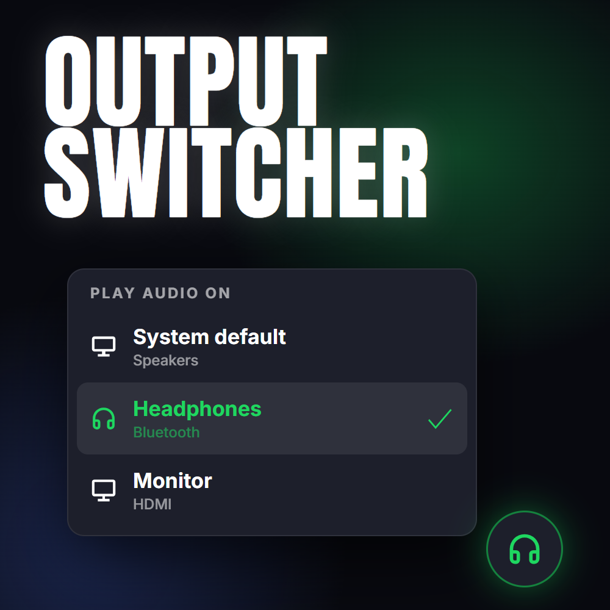
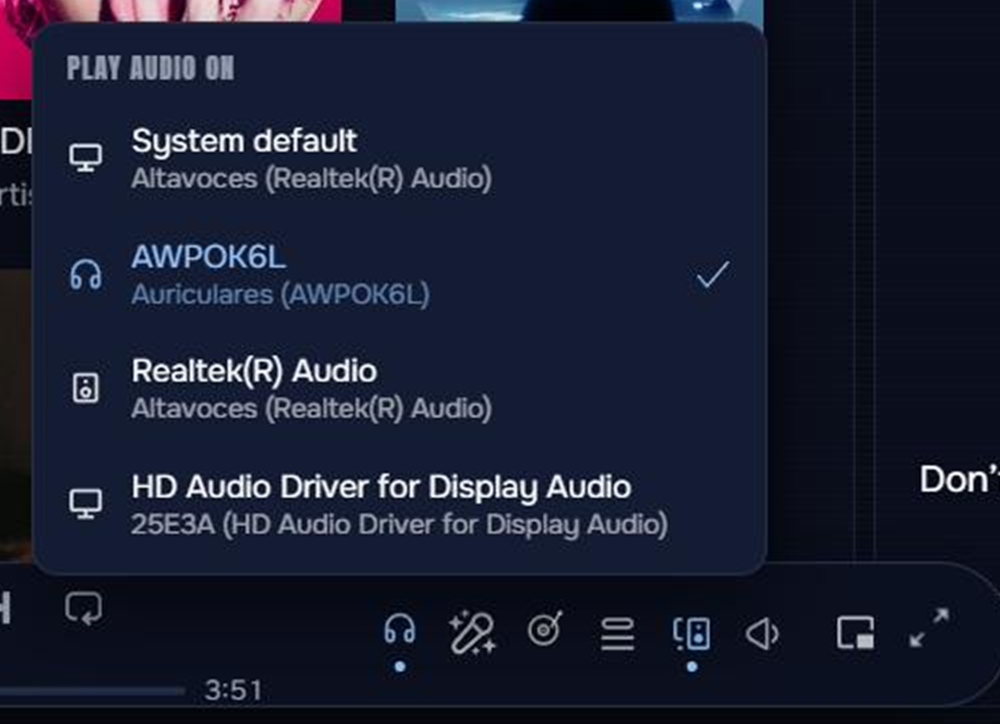

# Output Switcher

A Spicetify extension that puts Spotify's audio output picker in the player bar. Switch between your speakers, headphones and monitor in two clicks, without opening Settings.



## How it works

- A button in the player bar shows where Spotify is playing: **headphones**, **speakers** or **monitor**
- Click it to open the list of outputs, with a check on the one in use
- Pick one and Spotify switches to it straight away, and remembers it, just like the **Output** setting in Spotify's Settings
- **System default** follows whatever output Windows (or your system) is using
- The icon updates by itself when you change the output in Settings or plug in a device
- Works with the keyboard: arrow keys to move, Enter to choose, Esc to close



## Requirements

- [Spicetify](https://spicetify.app)
- A Spotify version with the **Output** option under Settings → Playback (Spotify 1.3.9 or newer). On older versions the extension simply does nothing

It works with any theme and pairs with [Vitral](https://github.com/SrPictus/vitral), [Mix Lyrics](https://github.com/SrPictus/mix-lyrics), [Mix Booth](https://github.com/SrPictus/mix-booth) and [Canvas Everywhere](https://github.com/SrPictus/canvas-everywhere). None of them are required.

## Install

### Marketplace (recommended)

Open the **Marketplace** in Spotify, go to the **Extensions** tab, search for **Output Switcher** and click **Install**. It updates on its own.

### Manual, on Windows

In PowerShell:

```powershell
Invoke-WebRequest -UseBasicParsing "https://raw.githubusercontent.com/SrPictus/output-switcher/main/output-switcher.js" -OutFile "$env:APPDATA\spicetify\Extensions\output-switcher.js"
```

```powershell
spicetify config extensions output-switcher.js
```

```powershell
spicetify apply
```

### Manual, on macOS and Linux

```bash
curl -fsSL https://raw.githubusercontent.com/SrPictus/output-switcher/main/output-switcher.js -o ~/.config/spicetify/Extensions/output-switcher.js
```

```bash
spicetify config extensions output-switcher.js
```

```bash
spicetify apply
```

### Uninstall

From the Marketplace, click **Uninstall** on Output Switcher. If you installed it by hand:

```bash
spicetify config extensions output-switcher.js-
```

```bash
spicetify apply
```

## Known limits

- It uses the same internal function as Spotify's own Output setting, which is still marked **Beta**, so a Spotify update can change it.
- It picks the output on this computer. To play on another device (a phone, a speaker, Alexa), use Spotify's **Connect** button as usual.
- Tested on Windows with Spotify 1.3.9.

## License

[MIT](LICENSE)
